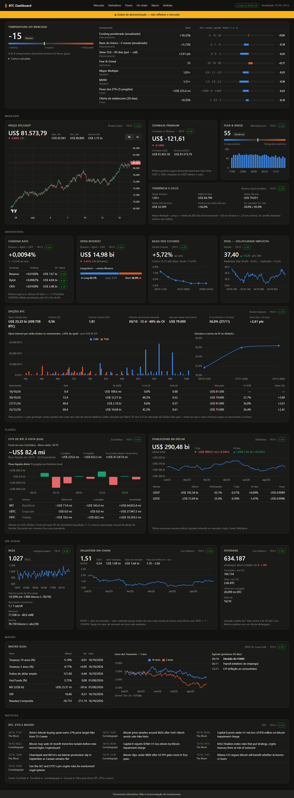
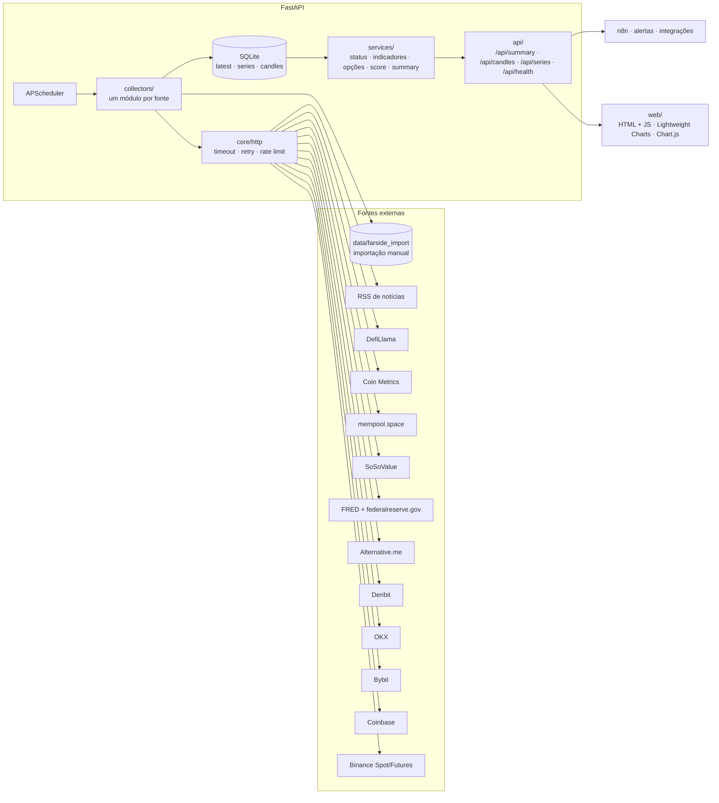

# BTC Dashboard

Painel de monitoramento do Bitcoin em tempo quase real que junta, em uma tela, os indicadores que traders profissionais acompanham: preço, derivativos, opções, fluxos de ETFs e stablecoins, on-chain, sentimento, macro e notícias, com uma faixa de resumo ("temperatura do mercado") no topo. Usa só APIs públicas e gratuitas, integradas diretamente em Python, sem ferramentas no-code.



> Ferramenta informativa. Não é recomendação de investimento.

## O problema

As informações relevantes para acompanhar o BTC estão espalhadas por exchanges, provedores de opções, índices de sentimento e bases macroeconômicas, cada um com seu formato, limite de requisições e instabilidades. Este projeto:

- **coleta** cada fonte em intervalos adequados, com retry, backoff e fallback entre exchanges;
- **normaliza e guarda** tudo em SQLite (cache + histórico), então o navegador nunca chama APIs externas;
- **calcula** indicadores derivados (Coinbase Premium, funding ponderado por open interest e z-score de 30 dias, basis anualizado, max pain, put/call, skew de 25 delta, Mayer Multiple, volatilidade realizada, NUPL);
- **resume** o estado do mercado num score descritivo, com o cálculo inteiro exposto;
- **expõe** um snapshot único em `GET /api/summary`, pronto para alertas e automações (n8n, Telegram, webhooks).

## Arquitetura



```
app/
├── main.py            # FastAPI + ciclo de vida (DB, HTTP, scheduler)
├── config.py          # configurações via .env
├── scheduler.py       # um job por coletor; grava sucesso/erro no cache
├── core/              # http.py (resiliência), db.py (SQLite), logging.py (JSON)
├── collectors/        # base.py (interface comum) + um módulo por fonte
├── services/          # status.py, indicators.py, options.py, regime.py, summary.py
└── api/routes.py
web/                   # index.html, app.js, styles.css
tests/                 # pytest + respx, com respostas reais gravadas em fixtures/
```

## Fontes de dados (Fase 1)

| Pilar | Fonte | Endpoints | Chave | Intervalo |
|---|---|---|---|---|
| Preço e candles | Binance Spot | `/api/v3/ticker/24hr`, `/api/v3/klines` (fallback: `data-api.binance.vision`) | Não | 1 min |
| Preço EUA | Coinbase Exchange | `/products/BTC-USD/ticker` | Não | 1 min |
| Funding, OI, long/short | Binance Futures | `/fapi/v1/premiumIndex`, `/fapi/v1/openInterest`, `/futures/data/openInterestHist`, `/futures/data/globalLongShortAccountRatio` | Não | 5 min |
| Derivativos (2ª fonte) | Bybit v5 | `/v5/market/tickers?category=linear` | Não | 5 min |
| Derivativos + preço (3ª fonte) | OKX v5 | `/market/ticker`, `/public/funding-rate`, `/public/open-interest` | Não | 5 min |
| Volatilidade implícita | Deribit | `public/get_volatility_index_data` (DVOL), `public/get_index_price` | Não | 15 min |
| Sentimento | Alternative.me | `/fng/?limit=30` | Não | 1 h |
| Macro | FRED | `series/observations` (DGS10, DGS2, DTWEXBGS, FEDFUNDS, WM2NS, VIXCLS, NASDAQCOM), `releases/dates` | **Sim** | 12 h |

## Fontes de dados (Fase 2)

| Pilar | Fonte | Endpoints | Chave | Intervalo |
|---|---|---|---|---|
| Opções e basis | Deribit | `public/get_book_summary_by_currency` (`kind=option` e `kind=future`) | Não | 15 min |
| Funding 30 dias | Binance Futures | `/fapi/v1/fundingRate` | Não | 5 min |
| Tendência | Binance Spot | `/api/v3/klines` com `interval=1w` (média de 200 semanas) | Não | 1 min |
| ETFs à vista | SoSoValue OpenAPI (principal) | `/etfs/summary-history`, `/etfs`, `/etfs/{ticker}/history` (`symbol=BTC`, `country_code=US`) | **Sim** | 12 h |
| ETFs à vista (reserva) | Farside Investors | importação manual de `data/farside_import.html` ou `.csv` | Não | 12 h |
| Stablecoins | DefiLlama | `stablecoins.llama.fi/stablecoins`, `/stablecoincharts/all` | Não | 6 h |
| Rede | mempool.space | `/v1/fees/recommended`, `/mempool`, `/v1/difficulty-adjustment`, `/v1/mining/hashrate/3m`, `/blocks/tip/height` | Não | 10 min |
| Valuation e atividade | Coin Metrics Community | `timeseries/asset-metrics` (CapMVRVCur, CapMrktCurUSD, AdrActCnt, TxCnt, FeeTotNtv, SplyCur) | Não | 6 h |
| Agenda do FOMC | Federal Reserve | `monetarypolicy/fomccalendars.htm` (junto com o FRED) | Não | 12 h |
| Notícias | CoinDesk, The Block, Cointelegraph, Decrypt | feeds RSS | Não | 15 min |

Observações:

- **SoSoValue** ([documentação](https://sosovalue-1.gitbook.io/sosovalue-api-doc)): chave por conta em `sosovalue.com/developer/dashboard`. O limite é por chave: 20 requisições/minuto e 100 mil/mês. Cada coleta faz cerca de 14 chamadas (resumo, lista e histórico de cada ETF). Com 2 coletas por dia são ~850/mês, e um reinício não gasta cota se o dado salvo tiver menos de 12 h. A API só devolve o último mês e liquida em T+1: o dia corrente aparece como pendente até o dia seguinte.
- **Termos da SoSoValue:** não há termos específicos da API publicados. Os termos gerais da plataforma ([Terms of Use](https://sosovalue.gitbook.io/helpdocument/resources/terms-of-use)) autorizam só **uso pessoal e não comercial** e proíbem reproduzir, republicar ou exibir publicamente o conteúdo (cláusulas 23, 26 e 29). Na prática: rodar o dashboard para você está ok; **não** hospede uma versão pública com os dados da SoSoValue nem publique dados dela. Por isso as fixtures de teste da SoSoValue são sintéticas.
- **Farside:** em 17/10/2026, o Cloudflare do site passou a responder 403 ao cliente Python (o curl passa, então o bloqueio é pela assinatura TLS, não pelos cabeçalhos). O projeto **não** tenta contornar a proteção. A tabela virou fonte de reserva por importação manual (abaixo).
- **Coin Metrics:** o plano gratuito não expõe o valor realizado (`CapRealUSD`), mas expõe o MVRV; valor realizado = valor de mercado ÷ MVRV e NUPL = 1 − 1/MVRV.
- **FOMC:** o FRED marca o release "FOMC Press Release" todo dia, então as datas das reuniões vêm do calendário oficial do Fed.

Todos os endpoints foram testados a partir do Brasil em 16 e 17/10/2026, sem bloqueio regional (exceto a coleta automática da Farside, acima). Binance e Bybit bloqueiam IPs dos EUA: se o projeto for hospedado lá, o coletor de spot usa o espelho `data-api.binance.vision` e o preço cai para OKX/Bybit.

## Como rodar

### Localmente (Windows, sem Docker)

Pré-requisito: Python 3.11+ (testado com 3.14). No Windows, use o launcher `py`.

```powershell
# 1. Criar e ativar o ambiente virtual
py -m venv .venv
.\.venv\Scripts\Activate.ps1
#    Se o PowerShell bloquear o script de ativação:
#    Set-ExecutionPolicy -Scope CurrentUser RemoteSigned

# 2. Instalar as dependências (requirements-dev inclui as de teste)
python -m pip install --upgrade pip
pip install -r requirements-dev.txt

# 3. Configurar o .env
copy .env.example .env
#    Edite o .env e preencha FRED_API_KEY e SOSOVALUE_API_KEY

# 4. Subir o servidor
uvicorn app.main:app --reload --port 8000
```

Abra http://localhost:8000. A documentação interativa da API fica em http://localhost:8000/docs.

Na primeira subida, os cards aparecem como "pendente" por alguns segundos, até cada coletor rodar.

No Linux/macOS: `python3 -m venv .venv && source .venv/bin/activate` e os mesmos passos a partir do 2.

### Com Docker

```bash
cp .env.example .env   # preencha FRED_API_KEY e SOSOVALUE_API_KEY
docker compose up -d --build
```

O banco SQLite fica em `./data`, montado como volume.

### Importação manual dos fluxos de ETF (reserva)

Sem `SOSOVALUE_API_KEY`, ou se a SoSoValue falhar, o card de ETFs lê um arquivo da Farside salvo por você. O card indica a fonte em uso, a data do último dado e, na reserva, o arquivo e quando ele foi salvo.

1. Abra https://farside.co.uk/btc/ no navegador.
2. Salve de um destes jeitos, dentro da pasta `data/` do projeto (no Docker, é o volume `./data`):
   - **HTML:** Ctrl+S → "Página da Web, somente HTML" → `data/farside_import.html`;
   - **CSV:** copie a tabela para uma planilha e exporte como `data/farside_import.csv`. A primeira coluna é a data (`16 Oct 2026` ou `2026-10-16`), depois uma coluna por ticker (`IBIT`, `FBTC`, …) e a coluna `Total`. Negativos podem vir entre parênteses. Separador `,` ou `;`; com `,`, ponha entre aspas os números com separador de milhar.
3. Pronto: o arquivo é lido na próxima coleta (a cada 12 h ou ao reiniciar o servidor). Se houver mais de um `farside_import.*`, vale o mais recente.

O arquivo passa pelas mesmas validações do leitor: soma dos ETFs = Total, faixa plausível e dias pendentes. Uma página de desafio do Cloudflare salva por engano gera erro claro. A pasta `data/` está no `.gitignore`.

### Testes

```powershell
pytest -q
```

Os coletores são testados com respostas reais gravadas em `tests/fixtures/` e mockadas com `respx`. Nenhum teste acessa a rede.

## API

| Rota | Descrição |
|---|---|
| `GET /api/summary` | Snapshot completo: score, preço, premium, tendência, derivativos, opções, basis, ETFs, stablecoins, on-chain, sentimento, macro, notícias e status de cada fonte |
| `GET /api/candles?interval=1h\|1d&limit=500` | OHLCV do BTCUSDT |
| `GET /api/series/{métrica}?days=30` | Histórico (ex.: `deribit.dvol`, `deribit.skew_25d_30d`, `etf.flow_total`, `stables.total_usd`, `cm.mvrv`, `fred.DGS10`) |
| `GET /api/health` | Status de cada coletor (`ok` / `atrasado` / `erro` / `pendente`) |

## Decisões técnicas

- **Uma interface para todos os coletores.** Cada fonte implementa `collect() → CollectorResult(data, series, candles)`. O scheduler grava o resultado sem conhecer a fonte, então adicionar uma fonte nova é criar um arquivo e registrá-lo.
- **Resiliência no cliente HTTP, não em cada coletor.**
  - Timeout configurável.
  - Retry com backoff exponencial e jitter só para erros transitórios (timeouts, 429 e 5xx), respeitando `Retry-After`.
  - Intervalo mínimo entre chamadas por host.
  - Erros 4xx não são repetidos.
- **Cache que sobrevive a falhas.** Quando uma coleta falha, o último dado válido fica no banco e só o status muda:
  - `atrasado`: falhou, mas o cache ainda está dentro de 3 ciclos;
  - `erro`: o cache venceu.

  O usuário sempre vê o que está acontecendo.
- **Fallback de preço.** A ordem é Binance → OKX → Bybit. O card indica qual fonte foi usada.
- **Coinbase Premium com ressalva.** O cálculo é Coinbase (USD) − Binance (USDT). Como USDT ≠ USD, um USDT a 0,999 já gera cerca de US$ 80 de "prêmio" com o BTC a US$ 80 mil. Serve como sinal de direção, não como arbitragem exata.
- **Funding ponderado por open interest** de Binance, Bybit e OKX, porque uma exchange com o dobro de OI pesa o dobro. A anualização assume 3 ciclos de 8h por dia.
- **Histórico próprio.** A Binance só devolve 30 dias de `openInterestHist`. Gravar as séries no SQLite permite calcular variações e correlações em janelas maiores.
- **Opções calculadas localmente.** Uma chamada traz a cadeia inteira da Deribit; delta (Black-76 sobre o forward, juros zero, como a Deribit precifica), max pain, put/call e skew de 25 delta saem de funções puras em `services/options.py`.
- **ETFs com fonte principal e reserva.** A SoSoValue (API com chave) vem primeiro; a tabela da Farside entra por importação manual quando a API não está disponível. As duas fontes saem no mesmo formato, então o card e o score não dependem de qual está em uso. O leitor da Farside localiza colunas pelo cabeçalho e valida cada linha (soma dos ETFs = Total, faixa plausível). Uma mudança de layout gera erro claro, e o card segue com o último dado bom.
- **Cota respeitada com cache.** Coletores com cota (`cache_on_restart`) não chamam a API no startup se o último dado bom ainda estiver dentro do intervalo.
- **Temperatura do mercado descritiva.** Oito componentes (funding, basis, skew, Fear & Greed, Mayer, MVRV, fluxo de ETFs e stablecoins) viram notas de −1 a +1 por âncoras fixas; o score é a média simples × 100, só com pelo menos 4 componentes. O `/api/summary` expõe valor, âncoras, nota e motivo de cada um, e o front mostra a conta inteira. Não é recomendação.
- **Log estruturado em JSON**, uma linha por evento, pronto para Loki, Datadog ou `jq`.
- **Front sem build.** HTML, CSS e JS puros servidos pelo FastAPI. O status de cada card usa ícone e rótulo, não só cor.

## Roadmap

- [x] **Fase 1:** preço, funding/OI, long/short, DVOL, Fear & Greed, macro FRED, cache e dashboard
- [x] **Fase 2:** opções (max pain, put/call, skew, IV a termo), basis, fluxo de ETFs (SoSoValue, com importação manual da Farside como reserva), on-chain (mempool.space e Coin Metrics), stablecoins (DefiLlama), notícias (RSS), indicadores derivados, score de temperatura e layout em seções
- [ ] Correlação de 30 dias do BTC com Nasdaq e dólar (ficou da Fase 2)
- [ ] **Fase 3:** alertas no Telegram com regras configuráveis e webhook para n8n
- [ ] **Fase 4:** resumo diário gerado pela API da Claude a partir do `/api/summary`
