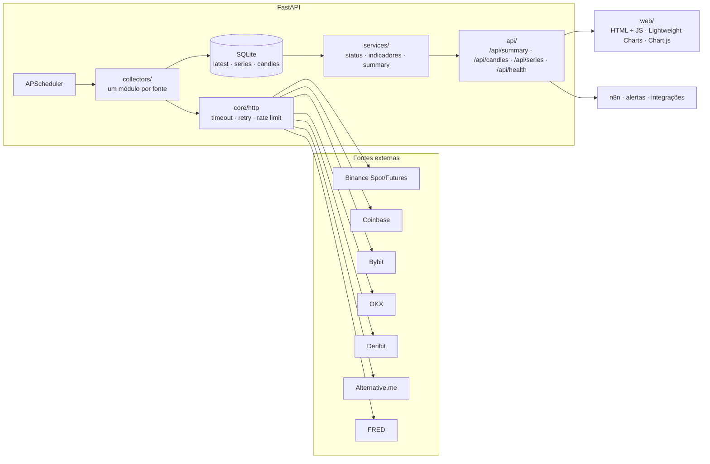

# BTC Dashboard

Painel de monitoramento do Bitcoin em tempo quase real que junta, em uma tela, os indicadores que traders profissionais acompanham: preço, derivativos, volatilidade implícita, sentimento e macro. Usa só APIs públicas e gratuitas, integradas diretamente em Python, sem ferramentas no-code.


> Ferramenta informativa. Não é recomendação de investimento.

## O problema

As informações relevantes para acompanhar o BTC estão espalhadas por exchanges, provedores de opções, índices de sentimento e bases macroeconômicas, cada um com seu formato, limite de requisições e instabilidades. Este projeto:

- **coleta** cada fonte em intervalos adequados, com retry, backoff e fallback entre exchanges;
- **normaliza e guarda** tudo em SQLite (cache + histórico), então o navegador nunca chama APIs externas;
- **calcula** indicadores derivados (Coinbase Premium, funding ponderado por open interest, variação de OI);
- **expõe** um snapshot único em `GET /api/summary`, pronto para alertas e automações (n8n, Telegram, webhooks).

## Arquitetura



```
app/
├── main.py            # FastAPI + ciclo de vida (DB, HTTP, scheduler)
├── config.py          # configurações via .env
├── scheduler.py       # um job por coletor; grava sucesso/erro no cache
├── core/              # http.py (resiliência), db.py (SQLite), logging.py (JSON)
├── collectors/        # base.py (interface comum) + um módulo por fonte
├── services/          # status.py, indicators.py, summary.py
└── api/routes.py
web/                   # index.html, app.js, styles.css
tests/                 # pytest + respx, com respostas reais gravadas em fixtures/
```

## Fontes de dados (Fase 1)

| Pilar | Fonte | Endpoints | Chave | Intervalo |
|---|---|---|---|---|
| Preço e candles | Binance Spot | `/api/v3/ticker/24hr`, `/api/v3/klines` (fallback: `data-api.binance.vision`) | Não | 1 min |
| Preço EUA | Coinbase Exchange | `/products/BTC-USD/ticker` | Não | 1 min |
| Funding, OI, long/short | Binance Futures | `/fapi/v1/premiumIndex`, `/fapi/v1/openInterest`, `/futures/data/openInterestHist`, `/futures/data/globalLongShortAccountRatio` | Não | 5 min |
| Derivativos (2ª fonte) | Bybit v5 | `/v5/market/tickers?category=linear` | Não | 5 min |
| Derivativos + preço (3ª fonte) | OKX v5 | `/market/ticker`, `/public/funding-rate`, `/public/open-interest` | Não | 5 min |
| Volatilidade implícita | Deribit | `public/get_volatility_index_data` (DVOL), `public/get_index_price` | Não | 15 min |
| Sentimento | Alternative.me | `/fng/?limit=30` | Não | 1 h |
| Macro | FRED | `series/observations` (DGS10, DGS2, DTWEXBGS, FEDFUNDS, WM2NS, VIXCLS, NASDAQCOM), `releases/dates` | **Sim** | 12 h |

Todos os endpoints foram testados a partir do Brasil em 16/10/2026, sem bloqueio regional. Binance e Bybit bloqueiam IPs dos EUA: se o projeto for hospedado lá, o coletor de spot usa o espelho `data-api.binance.vision` e o preço cai para OKX/Bybit.

## Como rodar

### Localmente (Windows, sem Docker)

Pré-requisito: Python 3.11+ (testado com 3.14). No Windows, use o launcher `py`.

```powershell
# 1. Criar e ativar o ambiente virtual
py -m venv .venv
.\.venv\Scripts\Activate.ps1
#    Se o PowerShell bloquear o script de ativação:
#    Set-ExecutionPolicy -Scope CurrentUser RemoteSigned

# 2. Instalar as dependências (requirements-dev inclui as de teste)
python -m pip install --upgrade pip
pip install -r requirements-dev.txt

# 3. Configurar o .env
copy .env.example .env
#    Edite o .env e preencha FRED_API_KEY

# 4. Subir o servidor
uvicorn app.main:app --reload --port 8000
```

Abra http://localhost:8000. A documentação interativa da API fica em http://localhost:8000/docs.

Na primeira subida, os cards aparecem como "pendente" por alguns segundos, até cada coletor rodar.

No Linux/macOS: `python3 -m venv .venv && source .venv/bin/activate` e os mesmos passos a partir do 2.

### Com Docker

```bash
cp .env.example .env   # preencha FRED_API_KEY
docker compose up -d --build
```

O banco SQLite fica em `./data`, montado como volume.

### Testes

```powershell
pytest -q
```

Os coletores são testados com respostas reais gravadas em `tests/fixtures/` e mockadas com `respx`. Nenhum teste acessa a rede.

## API

| Rota | Descrição |
|---|---|
| `GET /api/summary` | Snapshot completo: preço, premium, derivativos, DVOL, sentimento, macro e status de cada fonte |
| `GET /api/candles?interval=1h\|1d&limit=500` | OHLCV do BTCUSDT |
| `GET /api/series/{métrica}?days=30` | Histórico (ex.: `deribit.dvol`, `fng.value`, `binance.oi_usd`, `fred.DGS10`) |
| `GET /api/health` | Status de cada coletor (`ok` / `atrasado` / `erro` / `pendente`) |

## Decisões técnicas

- **Uma interface para todos os coletores.** Cada fonte implementa `collect() → CollectorResult(data, series, candles)`. O scheduler grava o resultado sem conhecer a fonte, então adicionar uma fonte nova é criar um arquivo e registrá-lo.
- **Resiliência no cliente HTTP, não em cada coletor.**
  - Timeout configurável.
  - Retry com backoff exponencial e jitter só para erros transitórios (timeouts, 429 e 5xx), respeitando `Retry-After`.
  - Intervalo mínimo entre chamadas por host.
  - Erros 4xx não são repetidos.
- **Cache que sobrevive a falhas.** Quando uma coleta falha, o último dado válido fica no banco e só o status muda:
  - `atrasado`: falhou, mas o cache ainda está dentro de 3 ciclos;
  - `erro`: o cache venceu.

  O usuário sempre vê o que está acontecendo.
- **Fallback de preço.** A ordem é Binance → OKX → Bybit. O card indica qual fonte foi usada.
- **Coinbase Premium com ressalva.** O cálculo é Coinbase (USD) − Binance (USDT). Como USDT ≠ USD, um USDT a 0,999 já gera cerca de US$ 80 de "prêmio" com o BTC a US$ 80 mil. Serve como sinal de direção, não como arbitragem exata.
- **Funding ponderado por open interest** de Binance, Bybit e OKX, porque uma exchange com o dobro de OI pesa o dobro. A anualização assume 3 ciclos de 8h por dia.
- **Histórico próprio.** A Binance só devolve 30 dias de `openInterestHist`. Gravar as séries no SQLite permite calcular variações e correlações em janelas maiores.
- **Log estruturado em JSON**, uma linha por evento, pronto para Loki, Datadog ou `jq`.
- **Front sem build.** HTML, CSS e JS puros servidos pelo FastAPI. O status de cada card usa ícone e rótulo, não só cor.

## Roadmap

- [x] **Fase 1:** preço, funding/OI, long/short, DVOL, Fear & Greed, macro FRED, cache e dashboard
- [ ] **Fase 2:** opções (max pain, put/call, basis), fluxo de ETFs (Farside), on-chain (mempool.space), stablecoins (DefiLlama), notícias (RSS) e correlação de 30 dias com Nasdaq e dólar
- [ ] **Fase 3:** alertas no Telegram com regras configuráveis e webhook para n8n
- [ ] **Fase 4:** resumo diário gerado pela API da Claude a partir do `/api/summary`
